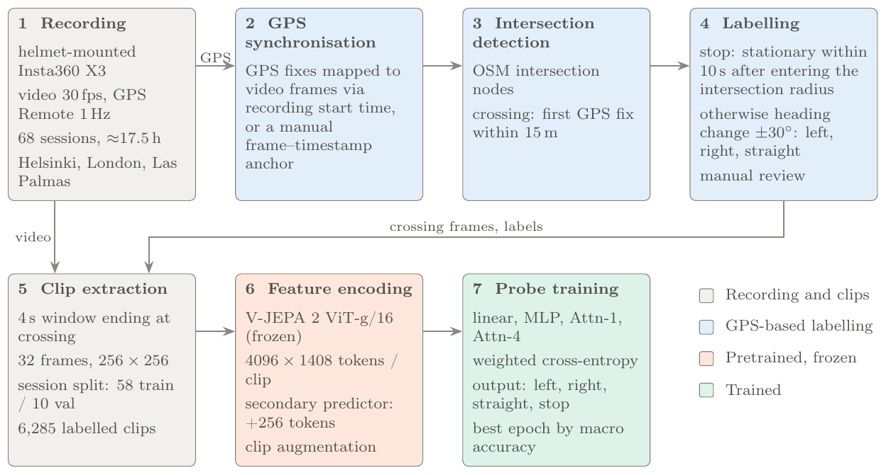

# Cyclist Maneuver Anticipation with V-JEPA 2

Master's thesis project (Data Science, University of Helsinki, 2026).

Can a frozen video world model anticipate what a cyclist will do at an intersection?
This repo uses probes and frozen [V-JEPA 2](https://github.com/facebookresearch/vjepa2) ViT-g representations of first-person
cycling video to classify the upcoming maneuver (**left, right, straight, or stop**) from video ending 15 m before
the intersection.

Frozen V-JEPA 2 features anticipate cyclist maneuvers at 51–56 % macro accuracy (chance 25 %). Much of that comes from
familiarity with the location: the linear probe scores 0.64 at intersections seen in training but 0.43 at unseen ones.
For attention probes the drop is not significant.



## Approach

1. **Labeling from GPS.** Ride GPS tracks are matched to OpenStreetMap intersections; the heading change through
   each intersection gives the maneuver label (`detect_intersections.py`).
2. **Clip extraction.** For each event, a 4 s clip is cut from the video ending at the crossing, when the cyclist
   enters the 15 m intersection radius (`extract_clips.py`).
3. **Frozen features.** Clips are encoded once with the frozen V-JEPA 2 ViT-g encoder, optionally concatenated with
   the frozen predictor's "imagined" future tokens (`encode_features.py`).
4. **Probing.** Lightweight probes (Linear, MLP, Attn-1, Attn-4) are trained on the cached features
   (`train_probe.py`), evaluated on held-out sessions (`eval_probe.py`).

Evaluation uses **macro-averaged accuracy** (mean per-class recall): there was severe class imbalance, with 87% of the labeled events as 'straight'.

## Results

| Experiment | Figure |
|---|---|
| Probe architecture comparison | [`results/figures/comparison/`](results/figures/comparison) |
| Encoder vs. encoder + predictor | [`results/figures/predictor/`](results/figures/predictor); per-probe details in [`results/figures/probes/`](results/figures/probes) (`pred_*` = with predictor) |
| Data scaling (25 / 50 / 75 / 100 %) | [`results/figures/comparison/heatmap.png`](results/figures/comparison/heatmap.png), `results/figures/probes/*_f0.*` |
| Accuracy vs. anticipation gap | [`results/figures/gap/`](results/figures/gap); per-probe `results/figures/probes/*/gap_analysis.png` |
| Seen vs. unseen intersections | [`results/figures/geo/`](results/figures/geo), [`results/tables/seen_unseen_accuracy.csv`](results/tables/seen_unseen_accuracy.csv) |

**Encoder-only features:**

| Probe | left | right | straight | stop | **Macro** | Best epoch |
|---|---|---|---|---|---|---|
| Linear | 0.462 | 0.373 | 0.623 | 0.606 | **0.516** | 27 |
| MLP | 0.513 | 0.431 | 0.647 | 0.576 | **0.542** | 28 |
| Attn-1 | 0.641 | 0.118 | 0.703 | 0.652 | **0.528** | 10 |
| Attn-4 | 0.410 | 0.549 | 0.717 | 0.439 | **0.529** | 5 |

**Encoder + predictor features:**

| Probe | left | right | straight | stop | **Macro** | Best epoch |
|---|---|---|---|---|---|---|
| Linear | 0.410 | 0.333 | 0.625 | 0.667 | **0.509** | 31 |
| MLP | 0.590 | 0.255 | 0.589 | 0.682 | **0.529** | 36 |
| Attn-1 | 0.718 | 0.275 | 0.652 | 0.409 | **0.513** | 8 |
| Attn-4 | 0.564 | 0.529 | 0.564 | 0.576 | **0.558** | 5 |

Per-class values are recall on the 10 validation sessions; chance macro accuracy is 0.25. Attn-1 / Attn-4 are
attentive poolers with 1 / 4 transformer blocks.

- **Checkpoint selection:** the reported checkpoint is the epoch with the highest validation macro accuracy. There is
  no separate test set, so these figures are optimistic.
- **Uncertainty:** differences between probes, and between encoder-only and encoder + predictor features, are within
  noise at this validation-set size. The tables do not establish a ranking.

## Limitations

- **Location familiarity.** The split is by session, not by location, so 51 % of validation events are at
  intersections that also appear in training. Direct overlap is rare: only 5–14 % of left, right and stop validation
  events have a training example at the same intersection, from the same approach direction, with the same maneuver.
  Yet Linear and MLP probes score 0.22 and 0.20 lower macro accuracy at unseen intersections, and the drop is
  almost entirely in the minority classes. The effect is broader than memorising "this approach means this maneuver"; the
  probes benefit from general familiarity with a location, so validation numbers overstate performance at new
  places. For attention probes the drop is not significant. A geographically grouped evaluation has not been run
  ([`results/figures/geo/`](results/figures/geo), [`seen_unseen_accuracy.csv`](results/tables/seen_unseen_accuracy.csv)).
- **Scene vs. motion.** It is not yet established whether the probes use the cyclist's movement or static scene
  cues such as intersection layout. The control experiment (encoding only the final frame) has not been run.
- **Label definitions.** Stop is a movement state while left, right and straight are directions. Stop takes
  precedence: a cyclist who stops and then turns is labelled stop, so part of the stop/turn confusion is
  definitional.
- **Anticipation gap.** GPS runs at 1 Hz, so gaps are whole seconds. Clips end at a fixed distance from the
  intersection, so the time gap is confounded with approach speed, and its distribution differs by class.
  Per-gap results ([`results/figures/gap/`](results/figures/gap)) should be read with that in mind.


## Repository layout

```
src/                  dataset, feature encoding, probe training and evaluation
scripts/data_prep/    GPS/IMU extraction, intersection detection, clip extraction, HDF5 packing
scripts/analysis/     result analysis and plotting
slurm/                SLURM jobs used on the CSC Roihu supercomputer
patches/              local modification to V-JEPA 2 (load encoder from a local checkpoint)
results/              aggregate figures and tables
```

## Setup

```bash
git clone https://github.com/facebookresearch/vjepa2
cd vjepa2 && git checkout 204698b45b3712590f06245fbfba32d3be539812
git apply ../cycling-anticipation/patches/vjepa2-checkpoint-path.patch
cd ../cycling-anticipation
pip install -r requirements.txt
```

Training example (on pre-encoded features):

```bash
python src/train_probe.py \
    --features features.h5 \
    --train_sessions train_sessions.txt \
    --val_sessions val_sessions.txt \
    --vjepa2_dir ../vjepa2 \
    --output_dir checkpoints/probe_attentive \
    --probe_type attentive
```

## Data

The dataset (first-person cycling video, GPS and IMU from rides in Helsinki) is **not included**: I do not hold
redistribution rights to all of it, and the GPS tracks are personal location data. The code documents the full
pipeline from raw recordings to features, so it can be applied to comparable data
(360°/action-camera video + GPS track per session).

## Acknowledgements

Built on [V-JEPA 2](https://github.com/facebookresearch/vjepa2) by Meta FAIR (MIT License); V-JEPA 2 code and weights
are not redistributed here. Computations run on CSC's Roihu supercomputer.

If you use this work, please also cite V-JEPA 2:

```bibtex
@article{assran2025vjepa2,
  title={V-JEPA~2: Self-Supervised Video Models Enable Understanding, Prediction and Planning},
  author={Assran, Mahmoud and Bardes, Adrien and Fan, David and Garrido, Quentin and Howes, Russell and
Komeili, Mojtaba and Muckley, Matthew and Rizvi, Ammar and Roberts, Claire and Sinha, Koustuv and Zholus, Artem and
Arnaud, Sergio and Gejji, Abha and Martin, Ada and Robert Hogan, Francois and Dugas, Daniel and
Bojanowski, Piotr and Khalidov, Vasil and Labatut, Patrick and Massa, Francisco and Szafraniec, Marc and
Krishnakumar, Kapil and Li, Yong and Ma, Xiaodong and Chandar, Sarath and Meier, Franziska and LeCun, Yann and
Rabbat, Michael and Ballas, Nicolas},
  journal={arXiv preprint arXiv:2506.09985},
  year={2025}
}
```
